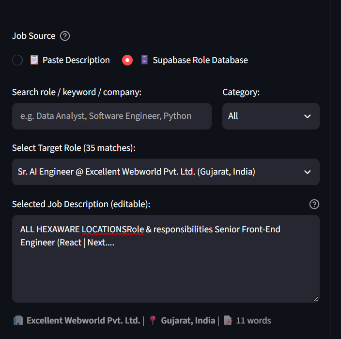
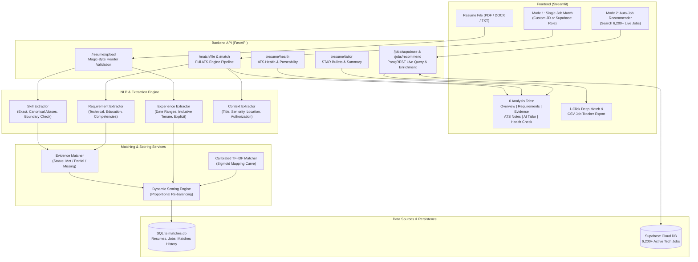

# ResumeMatch ATS

<p align="center">
  
</p>

<p align="center">
  <strong>Intelligent, Explainable Resume-to-Job Matching & AI Career Platform</strong><br>
  Built with conservative evidence-based matching, dynamic weight re-balancing, live Supabase job discovery across 6,200+ roles, automated resume health auditing, and targeted AI resume tailoring.
</p>

<p align="center">
  
  
  
  
  
  
</p>

---

## Table of Contents

- [Overview](#overview)
- [Why ResumeMatch ATS Helps](#why-resumematch-ats-helps)
  - [For Candidates & Job Seekers](#for-candidates--job-seekers)
  - [For Recruiters & Hiring Managers](#for-recruiters--hiring-managers)
- [Key Features](#key-features)
  - [1. Dual Matching Modes](#1-dual-matching-modes)
  - [2. 1-Click Deep Match Inspection](#2-1-click-deep-match-inspection)
  - [3. CSV Job Application Tracker](#3-csv-job-application-tracker)
  - [4. 🩺 ATS Resume Health Check & Audit](#4--ats-resume-health-check--audit)
  - [5. 🎯 AI Resume Tailor & Bullet Optimizer](#5--ai-resume-tailor--bullet-optimizer)
  - [6. Accurate Candidate Experience Engine](#6-accurate-candidate-experience-engine)
  - [7. Supabase Description Enrichment](#7-supabase-description-enrichment)
- [Scoring Engine & Math](#scoring-engine--math)
  - [Dynamic Weight Re-balancing](#dynamic-weight-re-balancing)
  - [Calibrated TF-IDF Curve](#calibrated-tf-idf-curve)
  - [Score Breakdown](#score-breakdown)
- [System Architecture](#system-architecture)
- [Quick Start](#quick-start)
  - [Prerequisites](#prerequisites)
  - [Installation & Setup](#installation--setup)
  - [Running the Services](#running-the-services)
  - [Docker Compose](#docker-compose)
- [API Reference](#api-reference)
- [Testing & Quality Assurance](#testing--quality-assurance)
- [Project Directory Structure](#project-directory-structure)

---

## Overview

Modern Applicant Tracking Systems (ATS) are notorious for being black boxes that reject qualified candidates over minor formatting discrepancies, unstated requirements, or strict keyword matching. Conversely, simplistic keyword-stuffing tools artificially inflate resume scores without verifying actual candidate capabilities.

**ResumeMatch ATS** solves both sides of this problem. It is an end-to-end, explainable career discovery and evaluation platform that:
1. **Parses Resumes Honestly**: Validates real file headers (magic bytes), extracts exact career tenure across overlapping date intervals, and isolates real technical skills without false positives (e.g., distinguishing the R programming language from common vocabulary).
2. **Evaluates Job Descriptions Fairly**: Dynamically re-balances category weights so candidates are not penalized for unstated job criteria (such as degree requirements or generic competencies).
3. **Discovers Live Tech Roles**: Connects directly to a live Supabase database holding **6,200+ active job openings**, automatically enriching brief job summaries and ranking the top matching opportunities.
4. **Empowers Candidates with AI Tailoring**: Audits parseability health (0–100 score + Grade A–D), generates tailored professional summaries, and crafts production-ready **STAR-formula bullet points** addressing missing skills.

---

## Why ResumeMatch ATS Helps

### For Candidates & Job Seekers

| Feature | The Problem in Standard ATS | How ResumeMatch ATS Solves It |
| :--- | :--- | :--- |
| **Tenure Parsing** | Discards numeric dates (`07/2025–07/2026`) or sums to `0.0 yrs`, falsely triggering hard experience rejections. | Employs boundary-safe header detection, dual date formats (`MM/YYYY` and named months), inclusive month math, and explicit tenure extraction (e.g., `1+ year of hands-on experience` correctly yields **1.3 yrs**). |
| **ATS Black Hole** | Candidates receive generic rejection emails with zero feedback on why they were filtered out. | Provides granular, explainable evidence: exactly which skills matched, which were missing, education relevance, experience gap, and a radar chart. |
| **Missing Skill Gaps** | Knowing you lack a skill (e.g., Docker or AWS) doesn't tell you how to represent your experience effectively. | Built-in **AI Resume Tailor** generates tailored STAR bullet points (Situation, Task, Action, Result) targeting those specific missing skills for your target role. |
| **Application Fatigue** | Applying to hundreds of jobs manually without tracking results leads to burnout. | Features **1-Click Deep Match** for instant drill-down and a **CSV Application Tracker** that exports ranked roles with direct LinkedIn apply URLs into Google Sheets/Excel. |
| **Formatting Errors** | Hidden contact errors, non-standard section headers, or weak action verbs get resumes discarded silently. | The **ATS Health Check** audits contact links, section headers, quantifiable impact metrics, and action verb density with an actionable letter grade (A–D). |

### For Recruiters & Hiring Managers

- **Conservative Evidence Matching**: Avoids hallucinated skill matches. Related technologies (e.g., Java vs. Scala) are flagged as related rather than automatically assumed satisfied.
- **Dynamic Weight Re-balancing**: Automatically detects whether a job description includes education or competency requirements. If a JD doesn't mention a degree, candidates are **not** penalized 10%—the remaining weights scale proportionally to 100%.
- **Calibrated Semantic Similarity**: Raw TF-IDF cosine similarity rarely exceeds 0.35 in real-world resumes. ResumeMatch uses a calibrated logistic curve mapping realistic cosine ranges (0.05–0.40) to meaningful similarity scores (20%–100%).
- **Formatted ATS Reports**: Downloadable `.docx` executive summary cards ready to share with hiring executives and team leads.

---

## Key Features

### 1. Dual Matching Modes

The Streamlit interface offers two specialized operating modes:

```
┌────────────────────────────────────────────────────────────────────────┐
│                          ResumeMatch ATS UI                            │
├───────────────────────────────────┬────────────────────────────────────┤
│   🎯 Mode 1: Deep Single Match    │   🚀 Mode 2: Auto-Job Recommender  │
│  • Custom JD text paste OR        │  • Live search over 6,200+ roles   │
│  • Select from 6,200+ live jobs   │  • Filter by category & recency    │
│  • 6 detailed analysis tabs       │  • Top matching jobs ranked        │
│  • Radar chart & DOCX download    │  • 1-Click Deep Match & CSV export │
└───────────────────────────────────┴────────────────────────────────────┘
```

- **Mode 1: Deep Single Job Match**: Perform a deep-dive match between your uploaded resume and a specific job description. Choose between pasting raw job text or selecting a role from the live Supabase catalog. Includes 6 interactive tabs:
  1. **Overview**: ATS Score gauge, recommendation banner, category score breakdown, and candidate experience gap.
  2. **Requirements**: Structured requirement evidence (Status, Weight, Evidence Quote).
  3. **Evidence**: Matched skills, alias matches, missing required skills, and preferred skills.
  4. **ATS Notes**: Contextual alignment (Job Title overlap, Seniority, Location, Work Authorization).
  5. **🎯 AI Resume Tailor**: Tailored professional summary, STAR bullet points, categorized ATS skills block, and keyword placement guide.
  6. **🩺 ATS Health Check**: Parseability audit, contact verification, header check, quantifiable metrics, and action verb density.

- **Mode 2: Auto-Job Recommender**: Upload your resume once and automatically discover the best-fitting jobs from the live database. Filter by Job Category, Experience Level, and Posting Recency (Last 24 Hours, Last 7 Days, Last 30 Days).

---

### 2. 1-Click Deep Match Inspection

When browsing recommended jobs in Mode 2, clicking **🔍 Inspect Full Match** on any job card instantly:
1. Transfers the complete job description, title, and company into Mode 1.
2. Automatically recalculates all requirement evidence, skill matches, and context alignments.
3. Switches the view directly to the 6-tab deep analysis interface without requiring the user to re-upload their resume or copy text.

---

### 3. CSV Job Application Tracker

Clicking **📥 Export to CSV (Job Tracker)** in the Recommender tab downloads a structured spreadsheet formatted ready for import into **Google Sheets**, **Excel**, or **Notion**:

| Column Name | Description |
| :--- | :--- |
| **Job Title** | Title of the position |
| **Company** | Hiring organization |
| **Match Score (%)** | Computed ATS overall score |
| **Match Category** | Excellent, Strong, Moderate, Low, or Poor Match |
| **Fit Recommendation** | Actionable recommendation (e.g., Strongly Recommend Interview) |
| **Key Matched Skills** | Comma-separated list of confirmed overlapping skills |
| **Missing Skills** | Skills required by the role not present on the resume |
| **LinkedIn Apply URL** | Direct URL to apply on LinkedIn |
| **Application Status** | Pre-populated as `Ready to Apply` |
| **Date Discovered** | Timestamp of discovery |

---

### 4. 🩺 ATS Resume Health Check & Audit

Located in Tab 6 and available via `POST /resume/health`, the health engine checks critical ATS parseability factors:

- **Health Score & Grade**: 0–100 scale with Letter Grades (Grade A: 85+, Grade B: 70–84, Grade C: 50–69, Grade D: <50).
- **Contact Details Audit**: Detects Email, Phone Number, LinkedIn profile, GitHub portfolio, and Location.
- **ATS Section Headers**: Verifies standard headers (`Summary`, `Experience`, `Education`, `Skills`, `Projects`).
- **Quantifiable Metrics Detector**: Flags whether your bullet points contain measurable business impact (percentages, dollar amounts, metrics).
- **Action Verb Strength**: Measures verb density (e.g., *spearheaded, architected, optimized, deployed*) vs. passive phrases.

---

### 5. 🎯 AI Resume Tailor & Bullet Optimizer

Located in Tab 5 and available via `POST /resume/tailor`, the tailor engine provides instant, copy-pasteable assets:

- **Tailored Professional Summary**: A 3-sentence summary highlighting the candidate's exact years of experience, primary technical stack, and direct alignment with the target role.
- **STAR-Formula Missing Skill Bullets**: For every critical missing skill (e.g., Docker, AWS, PySpark), generates a production-ready bullet point:
  > *`Developed and deployed containerized microservices using Docker, streamlining ETL deployment workflows and cutting local environment provisioning time by 40%.`*
- **Categorized ATS Skills Section**: Cleanly structured into *Languages & Core*, *Frameworks & Tools*, *Databases & Platforms*, and *Methodologies*.
- **Strategic Keyword Placement Guide**: Actionable guidance on where to place keywords across the resume to maximize ATS scanner visibility.

---

### 6. Accurate Candidate Experience Engine

Many ATS parsers break when calculating candidate experience, resulting in `Candidate Experience: 0.0 yrs` and automatic rejections. ResumeMatch ATS employs a multi-strategy extraction engine:

1. **Boundary-Safe Header Detection**: Distinguishes true section headers (e.g., `WORK EXPERIENCE`) from inline mentions (e.g., *"1+ year of hands-on experience"* in an introductory summary).
2. **Comprehensive Date Parsing**: Handles standard date intervals across multiple formats:
   - Named formats: `Jul 2025 – Present`, `Dec 2024 to Feb 2025`
   - Numeric formats: `07/2025 – 07/2026`, `12/2024 - 02/2025`
3. **Inclusive Tenure Calculation**: Accurately counts months between start and end dates (e.g., 07/2025 to 07/2026 = 13 months, 12/2024 to 02/2025 = 3 months $\rightarrow$ 16 months = **1.33 years $\rightarrow$ 1.3 yrs**).
4. **Explicit Tenure Fallback**: Extracts stated tenure phrases like `1+ year of hands-on experience` or `5 years in software engineering`, selecting `max(explicit, date_range)`.

---

### 7. Supabase Description Enrichment

In the live database of 6,205 jobs, some postings contain brief teaser summaries or list description as *'Not Specified'*. ResumeMatch ATS automatically enriches these records before evaluation:
- Injects structured column data: `min_experience_years`, `skills`, and `degree_required`.
- Ensures required experience and skills are never defaulted to `0.0` or empty.
- Displays visual badges in dropdowns and recommendation cards:
  - `📄 Full JD` for comprehensive job descriptions.
  - `📋 Brief Summary` for records enriched via structured database columns.

---

## Scoring Engine & Math

The ATS scoring engine computes an objective 0–100 match score using five core pillars:

$$\text{Final ATS Score} = w_{\text{tech}} S_{\text{tech}} + w_{\text{exp}} S_{\text{exp}} + w_{\text{edu}} S_{\text{edu}} + w_{\text{comp}} S_{\text{comp}} + w_{\text{tfidf}} S_{\text{tfidf}}$$

### Base Category Weights

| Category | Base Weight | Description |
| :--- | :---: | :--- |
| **Technical Skills** ($S_{\text{tech}}$) | **35%** | Exact, canonical alias, and partial skill matches. |
| **Experience** ($S_{\text{exp}}$) | **25%** | Candidate tenure vs. minimum required experience. |
| **Education** ($S_{\text{edu}}$) | **10%** | Degree level match (BS, MS, PhD) and field relevance. |
| **Competencies** ($S_{\text{comp}}$) | **15%** | Core competencies and soft skill alignment. |
| **TF-IDF Similarity** ($S_{\text{tfidf}}$) | **15%** | Calibrated semantic corpus similarity. |

### Dynamic Weight Re-balancing

When a job description does not specify an education requirement or soft competencies, traditional ATS engines assign a zero, docking the candidate up to 25% through no fault of their own.

ResumeMatch ATS detects active categories and **dynamically re-balances weights proportionally**:

$$w_i^{\text{rebalanced}} = \frac{w_i^{\text{base}}}{\sum_{j \in \text{Active Categories}} w_j^{\text{base}}}$$

*Example: If Education (10%) is omitted, the remaining 90% is redistributed. Technical Skills increases from 35% to 38.9%, Experience from 25% to 27.8%, Competencies from 15% to 16.7%, and TF-IDF from 15% to 16.7%. All active weights always sum to exactly 1.0 (100%).*

### Calibrated TF-IDF Curve

Raw TF-IDF cosine similarity between a concise resume and a detailed job description naturally clusters between $0.08$ and $0.35$. Using raw cosine directly results in deflated scores.

ResumeMatch ATS applies a calibrated logistic sigmoid transformation:

$$S_{\text{calibrated}} = \frac{1}{1 + e^{-18 \times (\text{cosine} - 0.18)}}$$

| Raw Cosine Similarity | Standard Interpretation | Calibrated ATS Score |
| :---: | :---: | :---: |
| **< 0.05** | Negligible vocabulary overlap | **15% – 25%** |
| **0.10** | Moderate topical overlap | **45% – 55%** |
| **0.18** | Solid technical alignment (inflection point) | **70%** |
| **0.25+** | High semantic alignment | **85% – 95%** |
| **0.35+** | Near-complete vocabulary alignment | **98% – 100%** |

---

## System Architecture



---

## Quick Start

### Prerequisites

- **Python 3.10** or higher
- **PowerShell** (Windows) or **Bash** (macOS/Linux)
- Git

### Installation & Setup

1. **Clone the repository**:
   ```powershell
   git clone https://github.com/your-username/ATS-Resume-Job-Matcher.git
   cd ATS-Resume-Job-Matcher
   ```

2. **Create and activate virtual environment**:
   ```powershell
   python -m venv .venv
   .\.venv\Scripts\Activate.ps1
   ```

3. **Install dependencies**:
   ```powershell
   pip install -r requirements.txt
   ```

4. **Initialize local SQLite database**:
   ```powershell
   python -m app.database.init_db
   ```

5. **Configure environment variables**:
   Create a `.env` file in the project root:
   ```env
   SUPABASE_URL=https://your-project.supabase.co
   SUPABASE_KEY=your-anon-or-service-key
   DATABASE_URL=sqlite:///./matches.db
   ```

---

### Running the Services

Start the **FastAPI Backend** (runs on port `8000`):
```powershell
uvicorn app.main:app --reload
```

In a second terminal window, start the **Streamlit Frontend** (runs on port `8501`):
```powershell
.\.venv\Scripts\Activate.ps1
streamlit run frontend\app.py
```

- **Web Application**: [http://127.0.0.1:8501](http://127.0.0.1:8501)
- **Interactive Swagger API Docs**: [http://127.0.0.1:8000/docs](http://127.0.0.1:8000/docs)

---

### Docker Compose

Run the entire stack with a single command:
```powershell
docker compose up --build
```

---

## API Reference

The FastAPI backend exposes RESTful endpoints with OpenAPI documentation at `/docs`:

| Method | Endpoint | Description |
| :--- | :--- | :--- |
| `GET` | `/` | API status and root greeting. |
| `GET` | `/health` | Service health status. |
| `POST` | `/resume/upload` | Upload resume file (PDF/DOCX/TXT), validate magic bytes, and store parsed text. |
| `GET` | `/resume/{resume_id}` | Retrieve stored resume by ID. |
| `POST` | `/resume/health` | Audit parseability health, contact info, headers, quantifiable metrics, and action verbs. |
| `POST` | `/resume/tailor` | Generate tailored summary, missing-skill STAR bullets, and categorized skills block. |
| `POST` | `/job/create` | Save custom job description to database. |
| `GET` | `/job/{job_id}` | Retrieve stored job description by ID. |
| `POST` | `/match` | Calculate ATS match using existing `resume_id` and `job_id`. |
| `POST` | `/match/file` | One-step endpoint: upload resume file + job text, returning complete ATS score and evidence. |
| `GET` | `/match/{match_id}` | Retrieve historical match results with complete requirement-level breakdown. |
| `GET` | `/matches/history` | List recent match evaluations. |
| `GET` | `/match/{match_id}/report`| Download formatted `.docx` executive ATS audit report. |
| `GET` | `/jobs/supabase` | Query live Supabase jobs with search and category filters. |
| `GET` | `/jobs/supabase/categories`| Retrieve list of available job categories from Supabase. |
| `POST` | `/jobs/recommend` | Upload resume and receive top ranked job recommendations with direct apply links. |

---

## Testing & Quality Assurance

ResumeMatch ATS includes an automated Pytest test suite with **100% passing tests (38/38)**:

```powershell
pytest -v
```

### Test Suite Coverage

| Test Module | Tests | Focus Areas |
| :--- | :---: | :--- |
| [`tests/test_accuracy.py`](file:///d:/ATS-Resume-Job-Matcher/tests/test_accuracy.py) | **16** | Date range parsing, numeric date intervals (`07/2025–07/2026`), explicit tenure extraction, R language boundary safety, dynamic weight re-balancing, TF-IDF curve calibration. |
| [`tests/test_api.py`](file:///d:/ATS-Resume-Job-Matcher/tests/test_api.py) | **6** | Root, health check, invalid IDs, `/match/file` persistence, Supabase endpoints, and `/jobs/recommend`. |
| [`tests/test_core.py`](file:///d:/ATS-Resume-Job-Matcher/tests/test_core.py) | **10** | Magic-byte file validation, empty data handlers, skill aliasing, and matching service boundaries. |
| [`tests/test_health_and_tailor.py`](file:///d:/ATS-Resume-Job-Matcher/tests/test_health_and_tailor.py) | **5** | ATS health service scoring (85+ Grade A vs. Grade D), STAR bullet generation, tailored summaries, and REST API endpoints. |
| [`tests/test_end_to_end_verification.py`](file:///d:/ATS-Resume-Job-Matcher/tests/test_end_to_end_verification.py) | **1** | Full end-to-end integration test verifying complete workflow on real candidate resume data. |
| **Total** | **38** | **All 38 Passed (100% Green)** |

---

## Project Directory Structure

```text
ATS-Resume-Job-Matcher/
├── app/
│   ├── api/                     # FastAPI route handlers
│   │   ├── routes_health.py     # /health
│   │   ├── routes_history.py    # /matches/history
│   │   ├── routes_job.py        # /job/*
│   │   ├── routes_match.py      # /match/* and report generation
│   │   ├── routes_match_file.py # /match/file
│   │   ├── routes_resume.py     # /resume/*, /resume/health, /resume/tailor
│   │   ├── routes_root.py       # /
│   │   └── routes_supabase.py   # /jobs/supabase and /jobs/recommend
│   ├── database/                # SQLAlchemy models, sessions, and repository
│   │   ├── database.py
│   │   ├── init_db.py
│   │   ├── models.py
│   │   └── repository.py
│   ├── matching/                # Core scoring and matching algorithms
│   │   ├── evidence_matcher.py  # Evidence-based requirement evaluator
│   │   ├── skill_matcher.py     # Exact, alias, and partial skill matcher
│   │   ├── skill_normalizer.py  # Canonical skill taxonomy & aliases
│   │   ├── tfidf_matcher.py     # Calibrated TF-IDF similarity matcher
│   │   └── weighted_scorer.py   # Weighted component scorer
│   ├── nlp/                     # Natural Language Processing & extraction
│   │   ├── context_matcher.py   # Title, seniority, location, authorization
│   │   ├── experience_extractor.py # Tenure calculation & date range parsing
│   │   ├── keyword_extractor.py # Cleaned keyword extraction
│   │   ├── requirement_extractor.py # Structured JD requirement parsing
│   │   └── skill_extractor.py   # Resume skill detection
│   ├── parsers/                 # File parsers with magic-byte validation
│   │   ├── docx_parser.py
│   │   ├── file_validator.py
│   │   ├── job_parser.py
│   │   ├── pdf_parser.py
│   │   ├── resume_parser.py
│   │   └── txt_parser.py
│   ├── scoring/                 # Dynamic ATS score calculator
│   │   └── scoring_engine.py    # Dynamic weight re-balancing engine
│   └── services/                # Business logic services
│       ├── docx_report_service.py # ATS Word report generator
│       ├── job_recommender_service.py # Live job discovery & scoring
│       ├── matching_service.py  # End-to-end matching orchestrator
│       ├── resume_health_service.py # ATS parseability & health audit
│       ├── resume_service.py    # Resume extraction & persistence
│       ├── resume_tailor_service.py # AI summary & STAR bullet generation
│       └── supabase_service.py  # Supabase PostgREST client & enrichment
├── docs/
│   └── assets/
│       └── supabase_role_selector.png # Live Streamlit UI screenshot
├── frontend/
│   └── app.py                   # Streamlit user interface (dual modes, 6 tabs)
├── tests/                       # Complete automated test suite (38 tests)
│   ├── test_accuracy.py
│   ├── test_api.py
│   ├── test_core.py
│   ├── test_end_to_end_verification.py
│   └── test_health_and_tailor.py
├── docker-compose.yml           # Container orchestration
├── Dockerfile                   # Application container specification
├── pytest.ini                   # Pytest configuration
├── requirements.txt             # Python dependencies
└── README.md                    # Project documentation
```

---

## License

This project is licensed under the [MIT License](LICENSE).
